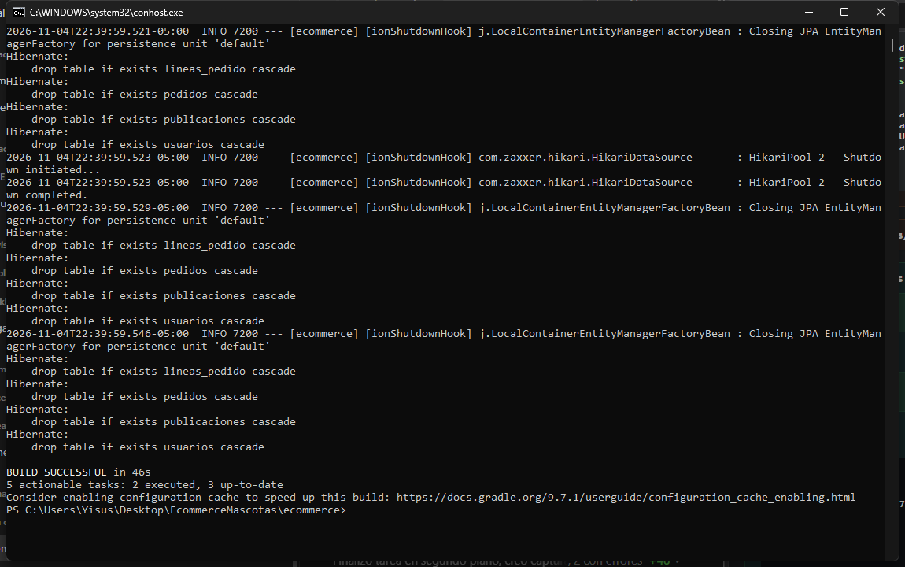
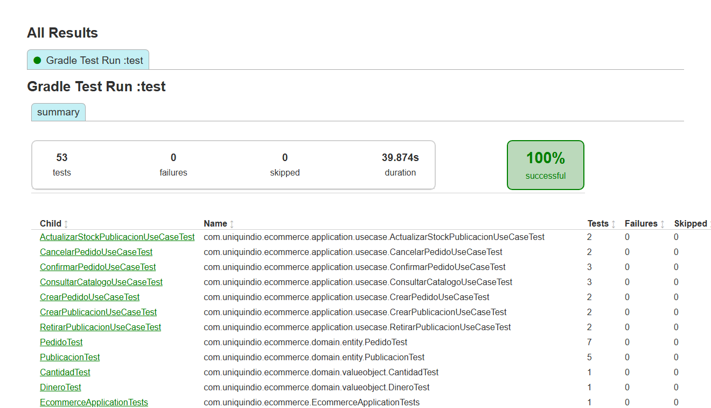

# EcommerceMascotas

**Nicho:** marketplace de productos para **perros y gatos** (alimento, juguetes, accesorios, higiene y salud). El vendedor publica sus productos con stock, y el comprador arma un pedido, lo confirma (se descuenta el stock) o lo cancela (el stock vuelve).
Proyecto del curso Programación Avanzada, Universidad del Quindío, 2026-2.

**Entrega 2:** backend completo, probado con Swagger: dominio, casos de uso, API REST, persistencia con JPA y H2, consultas, seguridad con JWT y pruebas. El frontend en Angular es la Entrega 3.

## Integrantes

| Integrante | GitHub | Qué hizo en la Entrega 2 |
|---|---|---|
| Jesús | [YisusLuligo](https://github.com/YisusLuligo) | Reorganización de las clases por tipo, configuración de la API (Swagger y manejo de errores), API de publicaciones del vendedor y seguridad con JWT |
| Nicol | [Nicolmarin12](https://github.com/Nicolmarin12) | Casos de uso del vendedor, prueba de controller con seguridad (`@WebMvcTest`) y prueba de integración |
| Esteban Carmona | [juanecarmonas-cpu](https://github.com/juanecarmonas-cpu) | Descripción obligatoria de la publicación, persistencia con JPA, consultas (catálogo paginado y ranking) y API de pedidos |

## Stack

- Java 21
- Spring Boot 4.1.1 (Gradle), Spring Data JPA, H2
- Spring Security con JWT (OAuth2 Resource Server) y BCrypt
- springdoc-openapi (Swagger)
- JUnit 5 y Mockito

## Estructura

```
ecommerce/src/main/java/com/uniquindio/ecommerce
├── domain
│   ├── entity        → Pedido, LineaPedido, Publicacion
│   ├── valueobject   → Dinero, Cantidad, Stock, EspecieDestino, PedidoId, PublicacionId,
│   │                   CompradorId, VendedorId, EstadoPedido, EstadoPublicacion, CategoriaProducto
│   ├── repository    → PedidoRepository, PublicacionRepository (interfaces), Pagina, PublicacionVentas
│   └── exception     → ReglaDominioException
├── application
│   ├── dto
│   │   ├── request   → CrearPublicacionRequest, ActualizarStockRequest, CrearPedidoRequest, LoginRequest, RegistroRequest
│   │   └── response  → PedidoResponse, PublicacionResponse, PageResponse, MasVendidaResponse, TokenResponse, UsuarioResponse
│   └── usecase       → vendedor: CrearPublicacionUseCase, ActualizarStockPublicacionUseCase, RetirarPublicacionUseCase
│                       comprador: CrearPedidoUseCase, ConfirmarPedidoUseCase, CancelarPedidoUseCase
│                       consultas: ConsultarCatalogoUseCase, ConsultarPedidosUseCase
└── infrastructure
    ├── config        → OpenApiConfig (Swagger)
    ├── persistence   → PedidoRepositoryEnMemoria, PublicacionRepositoryEnMemoria (solo para pruebas)
    │   └── jpa       → PedidoRepositoryJpa, PublicacionRepositoryJpa (+ sus repositorios de Spring Data), UsuarioJpaDataRepository
    │       ├── entity → PedidoEntity, LineaPedidoEntity, PublicacionEntity, DineroEmbeddable, UsuarioEntity, RolUsuario
    │       └── mapper → PedidoPersistenceMapper, PublicacionPersistenceMapper
    ├── security      → SecurityConfig (reglas de acceso), JwtConfig, JwtTokenProvider, AutenticacionService,
    │                   CustomUserDetails, UsuarioAutenticado, ManejadorErroresSeguridad, UsuariosIniciales
    └── rest          → AuthController, PublicacionController, ConsultasPublicacionController, PedidoController, ConsultasPedidoController
        ├── mapper    → PublicacionMapper, PedidoMapper (DTO ↔ dominio)
        └── exception → GlobalExceptionHandler
```

Las clases se organizan **por tipo** (entidades, value objects, repositorios, excepción, casos de uso, DTOs), siguiendo el repositorio guía del curso.
El paquete `domain` no depende de Spring, JPA ni Lombok. Los repositorios son interfaces en el dominio; la aplicación usa su implementación con JPA (`…RepositoryJpa`) y las versiones en memoria quedan para pruebas.

## Persistencia

- Base de datos H2 en memoria; las tablas se crean al arrancar: `publicaciones`, `pedidos` y `lineas_pedido`.
- Las entidades JPA (`infrastructure/persistence/jpa/entity`) son clases distintas de las entidades del dominio; un mapper convierte entre ellas usando `reconstruir(...)` del dominio.
- `data.sql` carga datos de prueba: 10 publicaciones de perro y gato (una AGOTADA y una RETIRADA) y 7 pedidos en distintos estados.
- Retirar una publicación no borra la fila: queda en estado RETIRADA (eliminación lógica).

## Seguridad (JWT)

### Usuarios de prueba

Se crean al arrancar (`UsuariosIniciales`) y sus ids son los mismos vendedores y compradores de `data.sql`, así cada uno ve sus propias publicaciones y pedidos.

| Correo | Contraseña | Rol | Qué tiene en los datos de prueba |
|---|---|---|---|
| `patitas@mascotas.com` | `vendedor123` | VENDEDOR | Tienda Patitas: publicaciones de perro (collar, concentrado, hueso, shampoo, correa) |
| `michi@mascotas.com` | `vendedor123` | VENDEDOR | Michi Store: publicaciones de gato (rascador, arena, snacks, desparasitante, cama) |
| `ana@mascotas.com` | `comprador123` | COMPRADOR | 3 pedidos (ENTREGADO, CONFIRMADO, CONFIRMADO) |
| `bruno@mascotas.com` | `comprador123` | COMPRADOR | 2 pedidos (ENVIADO, BORRADOR) |
| `carla@mascotas.com` | `comprador123` | COMPRADOR | 2 pedidos (CANCELADO, ENTREGADO) |

### Cómo probar en Swagger

1. `POST /api/auth/login` con `{"email": "ana@mascotas.com", "password": "comprador123"}` y copiar el `token`.
2. Botón **Authorize** (arriba a la derecha), pegar el token y **Authorize**. Desde ahí Swagger manda `Authorization: Bearer <token>` en cada petición.
3. Para cambiar de usuario: **Authorize → Logout** y pegar otro token.

### Endpoints de autenticación

| Método | Ruta | Qué hace |
|---|---|---|
| POST | `/api/auth/registro` | Crea una cuenta: `{"nombre", "email", "password" (mínimo 6), "rol": "COMPRADOR" o "VENDEDOR"}`. Responde 201; si el correo ya existe, 409 |
| POST | `/api/auth/login` | Revisa correo y contraseña y devuelve el token, su vencimiento y el rol. Si no coinciden, 401 |

### Quién puede usar cada ruta

| Rutas | Acceso |
|---|---|
| `/api/auth/**`, Swagger, consola H2 | Públicas |
| `GET /api/publicaciones/**` (catálogo, ranking, detalle) | Públicas |
| `POST /api/publicaciones`, `PUT /api/publicaciones/{id}/stock`, `DELETE /api/publicaciones/{id}` | Solo **VENDEDOR** |
| `/api/pedidos/**` | Solo **COMPRADOR** |

- **401**: sin token, con un token alterado o vencido. **403**: token válido pero de otro rol (por ejemplo, un comprador intentando publicar). Los dos responden un JSON con `mensaje`.
- Las reglas de acceso están en `infrastructure/security/SecurityConfig.java`.
- El comprador o vendedor **sale del token** (claim `uid`), no del body: nadie puede crear pedidos o publicaciones a nombre de otro. Si un comprador pide un pedido de otro comprador, o un vendedor intenta cambiar una publicación de otro vendedor, responde 404, como si no existiera.

### El token

- Lleva en el payload el correo (`sub`), el id (`uid`), el rol (`rol`), cuándo se emitió (`iat`) y cuándo vence (`exp`). Se puede leer en jwt.io porque solo está en base64, por eso **no** lleva la contraseña.
- Está firmado con HS256 y una clave secreta: si alguien cambia el payload, la firma deja de coincidir y la API responde 401.
- La clave (`jwt.secret`) y la duración (`jwt.expiracion-minutos`, 60) están en `application.properties`, no en el código.
- La API es **stateless**: no guarda sesiones. Cada petición trae su token y se valida sola.
- Las contraseñas se guardan con **BCrypt** (hash con sal, lento a propósito y que no se puede revertir), nunca en texto plano.

## Publicaciones (vendedor)

| Método | Ruta | Qué hace |
|---|---|---|
| POST | `/api/publicaciones` | Crea la publicación ya PUBLICADA. Responde 201 con la dirección de la publicación nueva |
| PUT | `/api/publicaciones/{id}/stock` | Cambia el stock (body `{"stock": 5}`); con 0 queda AGOTADA y si estaba agotada vuelve a PUBLICADA |
| DELETE | `/api/publicaciones/{id}` | Retira la publicación. Es una eliminación lógica: la fila no se borra, queda en estado RETIRADA y deja de salir en el catálogo |

- Requieren el token de un VENDEDOR. La publicación queda a nombre del vendedor del token, y cada vendedor solo cambia o retira las suyas.
- **400** cuando la petición viene incompleta (falta el nombre, la descripción, el precio…): lo revisan las validaciones del DTO.
- **409** cuando la petición está completa pero rompe una regla del negocio: especie distinta de PERRO o GATO, precio 0, descripción de más de 500 caracteres, stock negativo o retirar dos veces. Esas reglas viven en el dominio, no en el DTO.

## Consultas

| Método | Ruta | Qué hace |
|---|---|---|
| GET | `/api/publicaciones?texto=&especie=&categoria=&pagina=0&tamano=10` | Catálogo paginado: busca el texto en el nombre o la descripción y filtra por especie (`PERRO`, `GATO`) y categoría (`ALIMENTO`, `JUGUETE`, `ACCESORIO`, `HIGIENE`, `SALUD`). No muestra las publicaciones retiradas. Responde el contenido, `totalElementos` y `totalPaginas` |
| GET | `/api/publicaciones/mas-vendidas?limite=5` | Ranking de las publicaciones con más unidades vendidas (pedidos confirmados, enviados o entregados) |
| GET | `/api/publicaciones/{id}` | Detalle de una publicación (404 si no existe) |

- El catálogo es una consulta JPQL con parámetros con nombre, y el ranking usa `JOIN`, `GROUP BY` y `SUM`: el filtro, el conteo y la paginación los hace la base de datos, no Java.
- El dominio no usa la paginación de Spring: el adaptador convierte el `Page` de Spring en `Pagina`, que es del dominio.
- La página no puede ser negativa y el tamaño va de 1 a 50; si no, responde 400.

## Pedidos

| Método | Ruta | Qué hace |
|---|---|---|
| POST | `/api/pedidos` | Crea un pedido en BORRADOR con sus líneas. Responde 201 con la dirección del pedido nuevo |
| PUT | `/api/pedidos/{id}/confirmar` | Confirma el pedido y descuenta el stock de cada publicación |
| PUT | `/api/pedidos/{id}/cancelar` | Cancela el pedido; si ya estaba confirmado, el stock vuelve a las publicaciones |
| GET | `/api/pedidos` | Mis pedidos: los del comprador del token |
| GET | `/api/pedidos/{id}` | Detalle de uno de mis pedidos (404 si no existe o es de otro comprador) |

Todos requieren el token de un COMPRADOR. Ejemplo para crear un pedido de 2 rascadores (con el token de Bruno, por ejemplo):

```json
{
  "lineas": [{ "publicacionId": "b0b0b0b0-0000-4000-8000-000000000005", "cantidad": 2 }]
}
```

- El comprador no viaja en la petición: sale del token.
- El precio tampoco: lo toma el dominio de la publicación, así nadie puede mandar un precio inventado.
- Los casos de uso reciben tipos del dominio (`CompradorId`, `PedidoId`, `PublicacionId`, `Cantidad`) y devuelven el `Pedido`. `PedidoMapper` convierte el DTO en esos tipos y el `Pedido` en `PedidoResponse`, así el caso de uso no depende de HTTP.
- Errores de negocio a propósito para probar (409): pedir más unidades que el stock, pedir una publicación retirada (`…0009`), confirmar dos veces el mismo pedido o cancelar un pedido ENVIADO (`d0d0…0003`).

## Demo de punta a punta (en Swagger)

1. `POST /api/auth/login` como vendedor (`patitas@mascotas.com` / `vendedor123`) y pegar el token en **Authorize**.
2. `POST /api/publicaciones` para publicar un producto (responde 201 y el `id` de la publicación).
3. **Authorize → Logout**, `POST /api/auth/login` como comprador (`bruno@mascotas.com` / `comprador123`) y pegar ese token.
4. `POST /api/pedidos` con el `id` de la publicación y una cantidad (responde 201, pedido en BORRADOR).
5. `PUT /api/pedidos/{id}/confirmar`: el pedido queda CONFIRMADO y `GET /api/publicaciones/{id}` muestra el stock descontado.
6. **Error de negocio a propósito:** confirmar otra vez el mismo pedido responde **409** "Solo se puede confirmar un pedido en borrador". Esa excepción la lanza `Pedido.confirmar()` en el dominio y `GlobalExceptionHandler` la convierte en 409.
7. `PUT /api/pedidos/{id}/cancelar`: el pedido queda CANCELADO y el stock vuelve.
8. Seguridad: con el token del comprador, `POST /api/publicaciones` responde **403**; sin token, **401**.

## Correcciones de la Entrega 1

| Observación que nos dieron | Qué cambiamos | Dónde se ve (archivo o rama) |
|---|---|---|
| Las clases del dominio estaban mezcladas por agregado (entidades, enums, value objects e interfaces en la misma carpeta) | Las reorganizamos por tipo: `domain/entity`, `domain/valueobject`, `domain/repository` y `domain/exception`; los casos de uso pasaron a `application/usecase` con el sufijo `UseCase`, y los DTOs a `dto/request` y `dto/response`. La lógica no cambió y las pruebas siguen en verde | `ecommerce/src/main/java/com/uniquindio/ecommerce/domain/`, rama `fix/estructura-por-tipo` |
| La publicación tenía que tener una descripción, sí o sí | `Publicacion` tiene una `descripcion` obligatoria, protegida como invariante en `crear(...)`: no puede ser vacía ni superar 500 caracteres. Se agregó al DTO `CrearPublicacionRequest`, a la documentación y una prueba que lo demuestra | `domain/entity/Publicacion.java`, `PublicacionTest.crearPublicacionSinDescripcion…`, rama `fix/descripcion-publicacion` |

### Otras mejoras que encontramos al revisar el código

| Problema | Qué cambiamos | Dónde se ve |
|---|---|---|
| `confirmar()` solo revisaba el stock: si el vendedor retiraba una publicación mientras el pedido estaba en borrador, el error salía después, al descontar el stock | `Pedido.confirmar()` ahora revisa que cada publicación siga aceptando pedidos antes de pasar a CONFIRMADO; nueva prueba que lo demuestra | `domain/entity/Pedido.java`, `PedidoTest.confirmarConUnaPublicacionRetirada…` |
| Cuando un pedido o una publicación no existía, el caso de uso lanzaba `ReglaDominioException`, igual que si se rompiera una regla | Ahora lanza `NoSuchElementException` (se podrá responder 404), y `ReglaDominioException` queda solo para reglas de negocio rotas | `application/usecase/CrearPedidoUseCase.java`, `ConfirmarPedidoUseCase.java` |
| `diagrama-agregado.md` hablaba de "PedidoMascotas" y "productos", términos que no están en el lenguaje ubicuo | Se usa "Pedido" y "línea de pedido", igual que en el código | `diagrama-agregado.md` |
| Los casos de uso recibían un DTO (`CrearPedidoRequest`, `CrearPublicacionRequest`) o devolvían uno (`PedidoResponse`), y eso dejaba la capa de aplicación amarrada a la API | Ahora reciben tipos del dominio y devuelven la entidad (`Pedido`, `Publicacion`); `PedidoMapper` y `PublicacionMapper` hacen la conversión en los dos sentidos | `application/usecase/CrearPedidoUseCase.java`, `CrearPublicacionUseCase.java`, `infrastructure/rest/mapper/` |

## Documentación

- [Lenguaje ubicuo](lenguaje-ubicuo.md)
- [Clasificación entidad / value object](clasificacion-entidades-vo.md)
- [Reto de diseño y reglas de negocio](reto-diseno.md)
- [Agregados, invariantes y diagrama](diagrama-agregado.md)
- [Casos de uso](casos-de-uso.md)
- [DTOs](dtos.md)

## Cómo ejecutar el proyecto

Requisitos: Java 21. Desde la carpeta `ecommerce`:

```bash
./gradlew bootRun
```

En Windows: `gradlew.bat bootRun`. Con la aplicación corriendo:

| Qué | Dirección |
|---|---|
| Swagger (probar la API) | http://localhost:8080/swagger-ui.html |
| Documentación OpenAPI en JSON | http://localhost:8080/api-docs |
| Consola de la base de datos H2 | http://localhost:8080/h2-console (JDBC URL: `jdbc:h2:mem:ecommercedb`, usuario `sa`, sin contraseña) |

Errores de la API: 400 datos inválidos, 401 sin token o login fallido, 403 rol sin permiso, 404 el recurso no existe, 409 se rompió una regla de negocio. Todos responden un JSON con `status`, `error` y `mensaje`.

## Pruebas

53 pruebas en verde, todas con el patrón AAA (Arrange, Act, Assert):

| Tipo | Clases | Qué comprueban |
|---|---|---|
| Dominio (JUnit puro) | `PedidoTest`, `PublicacionTest`, `DineroTest`, `CantidadTest` | Las invariantes de los agregados y los value objects, incluidos los casos que rompen una regla |
| Casos de uso (Mockito) | `CrearPedido…`, `ConfirmarPedido…`, `CancelarPedido…`, `CrearPublicacion…`, `ActualizarStockPublicacion…`, `RetirarPublicacion…`, `ConsultarCatalogo…UseCaseTest` | Que cada caso de uso coordina bien. Cuando se rompe una regla, comprueban con `verify(..., never()).guardar(...)` que no se guarda nada |
| Controller (`@WebMvcTest`) | `PedidoControllerTest`, `PedidoControllerErroresTest` | 201 con `Location`; **401 sin token, 403 con el rol equivocado y 201 con el rol correcto**; 400 por validación; 404 y 409 con su mensaje, y que en esos errores **nunca se llama a `guardar`** |
| Seguridad (`@SpringBootTest`) | `SeguridadMisPedidosTest` | Sobre `GET /api/pedidos`: **401 sin token, 403 con token de vendedor y 200 con token de comprador** |
| Repositorio (`@DataJpaTest`) | `PedidoRepositoryJpaTest`, `PublicacionRepositoryJpaTest`, `ConsultasPublicacionRepositoryJpaTest` | Que el agregado se guarda y se lee completo; la consulta paginada y el ranking sobre `data.sql` |
| Integración (`@SpringBootTest`) | `FlujoPedidoIntegracionTest`, `EcommerceApplicationTests` | El sistema real sin simular nada: login con BCrypt y JWT, crear y confirmar un pedido, y que el stock baje en la base |

## Pruebas avanzadas

Qué prueba cubre cada punto del seguimiento:

| Punto | Dónde está |
|---|---|
| 0. Repositorio | `PedidoRepositoryJpaTest` y `PublicacionRepositoryJpaTest`: guardar y recuperar, con `Dinero`, los enums y las líneas intactos. `ConsultasPublicacionRepositoryJpaTest`: la paginación del catálogo (9 publicaciones en 3 páginas) y el ranking con JOIN y GROUP BY (primero el Collar reflectivo) |
| 1. Endpoint con seguridad | `SeguridadMisPedidosTest` |
| 2. `@DataJpaTest` | `PedidoRepositoryJpaTest`, `PublicacionRepositoryJpaTest` y `ConsultasPublicacionRepositoryJpaTest` |
| 3. Prueba de integración | `FlujoPedidoIntegracionTest` |
| 4. Más casos en el controller | `PedidoControllerErroresTest`: 404 y 409, y en los dos `verify(..., never()).guardar(...)` |

### 1. Probar un endpoint con seguridad

- Escogimos `GET /api/pedidos` (mis pedidos), que según `SecurityConfig` solo la puede usar el rol COMPRADOR.
- Usamos `@SpringBootTest` con `@AutoConfigureMockMvc` para que se cargue nuestra `SecurityFilterChain` de verdad; con un `@WebMvcTest` solo, Spring pone una seguridad por defecto y no la nuestra.
- Sin token responde 401 porque la API no sabe quién es. Con un token de VENDEDOR responde 403: sabe quién es, pero su rol no alcanza. Con un token de COMPRADOR responde 200 y trae los 3 pedidos de Ana que hay en `data.sql`.
- El token no sale del login: lo simulamos con `jwt()` de `spring-security-test`, que mete en la petición un usuario con el `uid` y el rol que le digamos.
- La autoridad va sin el prefijo `ROLE_` (`"COMPRADOR"`), igual que en nuestro `JwtConfig`.
- Lo que más nos costó: entender por qué en `PedidoControllerTest`, que es `@WebMvcTest`, teníamos que importar a mano `SecurityConfig`, `JwtConfig` y `ManejadorErroresSeguridad` para que el 401 y el 403 salieran con nuestras reglas.

### 2. `@DataJpaTest` frente a `@SpringBootTest`

- `@DataJpaTest` levanta solo la persistencia: entidades, repositorios de Spring Data y una base H2 de prueba. No carga controllers, ni seguridad, ni nuestros adaptadores.
- Por eso en cada prueba traemos el adaptador y su mapper con `@Import`, por ejemplo `@Import({PublicacionRepositoryJpa.class, PublicacionPersistenceMapper.class})`. Sin eso la prueba falla porque no encuentra el bean.
- Cada prueba corre en una transacción que se deshace al final, así una prueba no le cambia los datos a la otra. Es más rápida porque no arranca toda la aplicación.
- `@SpringBootTest` levanta la aplicación completa. Es más lenta y la usamos cuando queremos probar todo junto: la seguridad (punto 1) y la integración (punto 3).
- En Spring Boot 4 `@DataJpaTest` cambió de paquete: ahora es `org.springframework.boot.data.jpa.test.autoconfigure.DataJpaTest`. Además, las pruebas de cada tecnología quedaron en su propio starter, así que agregamos `testImplementation 'org.springframework.boot:spring-boot-starter-data-jpa-test'` al `build.gradle`; sin ese starter la anotación no existe y no compila.
- Revisamos que `data.sql` sí se cargue en estas pruebas: el catálogo da 9 publicaciones y el ranking pone primero el Collar reflectivo.

### 3. Prueba de integración

- Una prueba unitaria prueba una sola clase y simula con Mockito todo lo que esa clase usa. Es rápida, pero no asegura que las piezas funcionen juntas.
- La de integración, `FlujoPedidoIntegracionTest`, recorre el sistema real sin simular nada: login con BCrypt y JWT, controller, caso de uso, dominio, repositorio JPA y la base H2 con `data.sql`.
- En la prueba, Bruno inicia sesión, crea un pedido de 2 rascadores, lo confirma, y al final se revisa en la base que el stock bajó 2 unidades.
- Detecta errores que las unitarias no ven, por ejemplo un mapeo de JPA mal hecho o una regla de seguridad mal escrita.
- La desventaja es que es más lenta y depende de los datos de `data.sql`: si alguien los cambia, la prueba se rompe. Lleva `@Transactional` para deshacer lo que guarda.
- Conviene para uno o dos flujos importantes del negocio; los casos de borde se prueban mejor con pruebas unitarias.
- Lo que más nos costó: sacar el token de la respuesta del login dentro de la misma prueba para usarlo en las siguientes peticiones (lo leímos con `JsonPath`).

### Captura de `./gradlew test` en verde

Las 53 pruebas pasan (`gradlew.bat cleanTest test` en la carpeta `ecommerce`):





## Cómo correr las pruebas

Desde la carpeta `ecommerce`:

```bash
./gradlew test
```

En Windows (cmd o PowerShell):

```bash
gradlew.bat test
```
